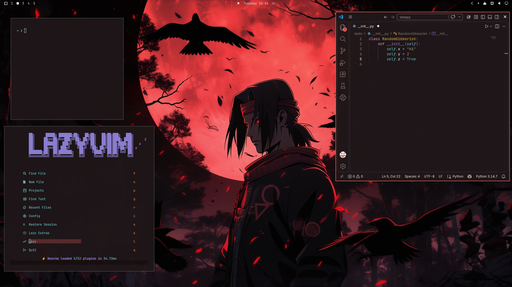

# Itachi

An [Omarchy](https://omarchy.org) theme — dark, warm-black and crimson, with
Yaru-red file manager icons.



## Install

In the Omarchy menu: **Install > Style > Theme**, and paste:

```
https://github.com/ciancomerford21-spec/omarchy-itachi-theme
```

Or from the command line:

```bash
omarchy theme install https://github.com/ciancomerford21-spec/omarchy-itachi-theme
omarchy theme set itachi
```

The `omarchy-` prefix and `-theme` suffix are stripped at install time, so the
theme shows up in the menu as just **itachi**.

## What it changes

`colors.toml` drives the terminal (Alacritty/Foot/Ghostty/Kitty), btop,
Chromium, Hyprland, Neovim, Helix, VS Code, Obsidian, and the whole Omarchy
shell — bar, menu, notifications, OSD and lock screen.

| Key | Value | Role |
| --- | --- | --- |
| `accent` | `#dc5b56` | crimson accent |
| `background` | `#1e1618` | warm black |
| `dark_background` | `#180f11` | lock screen, menus |
| `darker_background` | `#110b0c` | terminal background |
| `lighter_background` | `#2a1e20` | raised surfaces |
| `foreground` | `#ece3e0` | primary text |

Also included:

- `icons.theme` — `Yaru-red` icon set
- `unlock.png` / `preview-unlock.png` — lock screen art, listed under
  **Style > Unlock**
- `backgrounds/0-itachi.jpg` — wallpaper (cycle with `omarchy theme bg next`)

## Requirements

Omarchy 4.x on Hyprland. No scripts, no `.lua`, no terminal configs — installing
this theme changes how your desktop looks, never what it runs.

## License

MIT. See [LICENSE](LICENSE).
